# Эталонный процесс разработки программного обеспечения с использованием ИИ

**Версия:** 1.0.0

**Статус:** согласованная редакция

**Дата актуализации:** 2026-11-02

**Идентификатор редакции:** Git-коммит или тег, содержащий эту версию файла

## 1. Назначение документа

Этот документ задаёт эталонный процесс разработки приложения: от анализа требований и проектирования архитектуры до реализации, тестирования, развёртывания и последующего управления изменениями.

Документ предназначен одновременно для:

- заказчика и владельца продукта;
- системного архитектора;
- команды разработки и эксплуатации;
- ИИ-агента, выполняющего анализ, проектирование, планирование, реализацию и проверку;
- аудита состава и состояния проектных артефактов.

ИИ должен использовать этот документ как регламент работы, но не как источник продуктовых требований. Фактические требования, архитектура и спецификации находятся в соответствующих каталогах проекта.

## 2. Основные принципы

1. Каждый этап создаёт сохраняемый и проверяемый артефакт.
2. ИИ готовит анализ, варианты решений, диаграммы, спецификации, планы, код и тесты.
3. Человек утверждает требования, существенные архитектурные решения, спецификационные изменения, приёмку и выпуск.
4. C4 используется для архитектурных представлений, arc42 — для структуры архитектурной документации.
5. SDD связывает бизнес-сценарии, спецификации, планы, тесты и реализацию.
6. Исходный материал не становится требованием автоматически; происхождение исходников и созданные проектом артефакты учитываются раздельно.
7. Каждый вид информации имеет один канонический источник, а связи между источниками, требованиями, архитектурой, SDD, тестами и выпуском ведутся в сквозной трассировке.
8. OpenSpec-like подход отделяет действующие спецификации от предлагаемых изменений.
9. Действующая спецификация не изменяется до утверждения, реализации и успешного развертывания изменения в промышленном контуре.
10. Планирование и контроль охватывают все 14 этапов, ведутся только в Git и уточняются скользящим способом.
11. Между этапами независимо проверяются выходная готовность текущего и входная готовность следующего этапа.
12. Длинные обратные линии на общей схеме заменяются маркированными возвратами `R1…R27`.
13. Если дальнейший этап обнаруживает дефект более раннего артефакта, процесс возвращается к источнику дефекта, а не маскирует его локальной правкой.
14. Критические допущения и открытые вопросы должны быть закрыты либо явно приняты до фиксации baseline.
15. Утверждённые артефакты не переписываются без истории: после baseline применяется анализ влияния и управляемая дельта; черновые рабочие материалы могут редактироваться непосредственно.

## 3. Общая схема процесса

Схема разделена по согласованным этапам жизненного цикла. Каждый этап показан отдельной вертикальной диаграммой; узел перехода в конце этапа соответствует межэтапной контрольной точке и входу следующего этапа. На этой точке уточняется план следующего этапа, проверяются выходная и входная готовность и одним изменением в Git фиксируются переход и новый оперативный контекст. Маркированные возвраты не рисуются длинными линиями; их назначения приведены внутри схем и в разделе 8.

Во всех диаграммах используется единая нейтральная палитра: серые блоки обозначают работу, бежевые — контрольные точки, приглушённые розовые — возвраты, серо-зелёные — переходы и зафиксированные результаты.

### 3.1 Этап 1 — Анализ и определение продукта

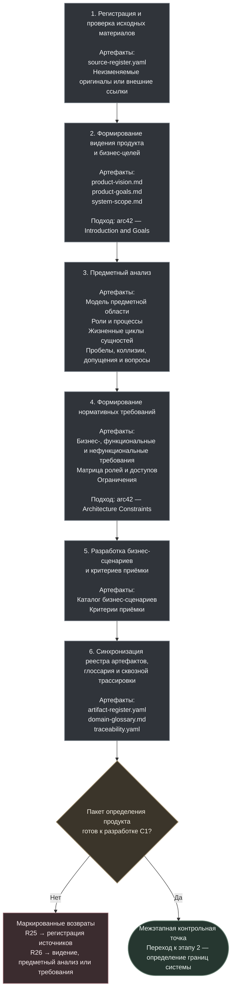

### 3.2 Этап 2 — Определение границ системы

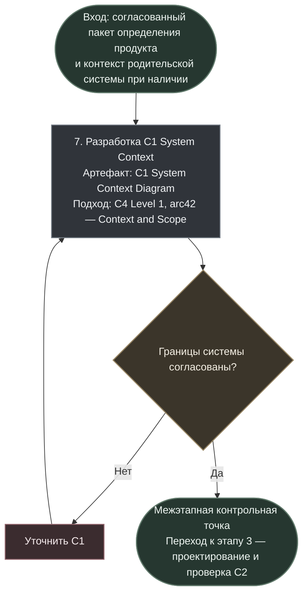

### 3.3 Этап 3 — Проектирование и проверка C2

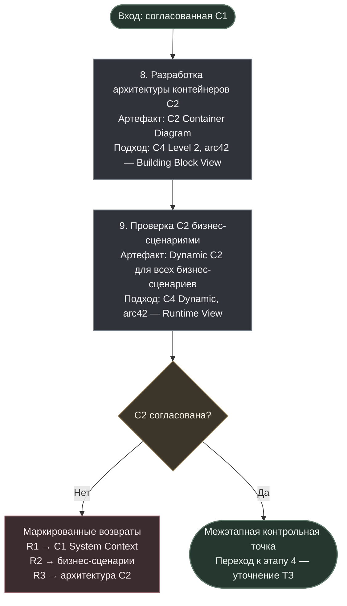

### 3.4 Этап 4 — Уточнение ТЗ

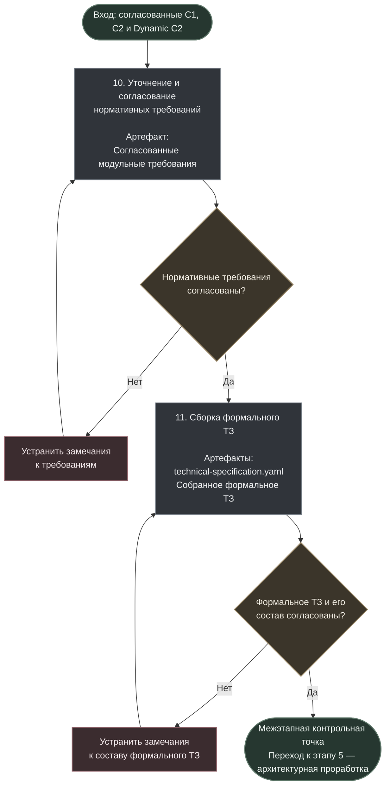

### 3.5 Этап 5 — Архитектурная проработка

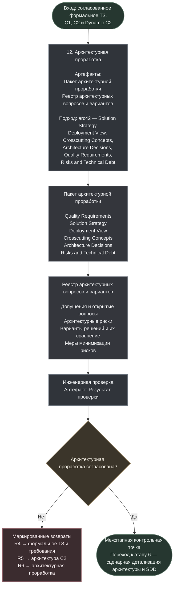

### 3.6 Этап 6 — Сценарная детализация архитектуры и SDD

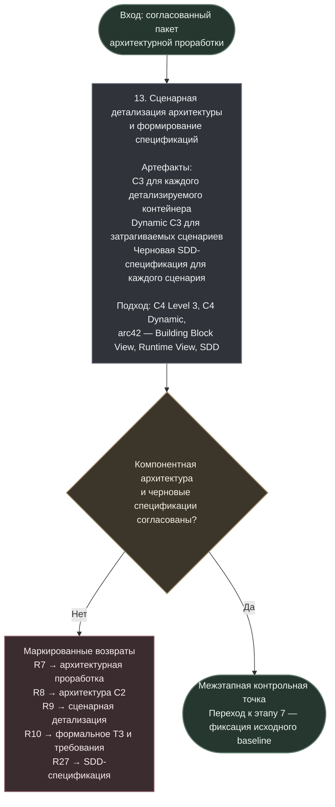

### 3.7 Этап 7 — Фиксация исходного baseline

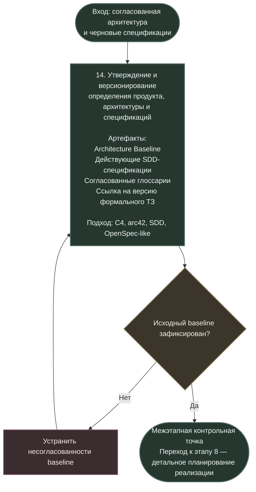

### 3.8 Этап 8 — Детальное планирование реализации

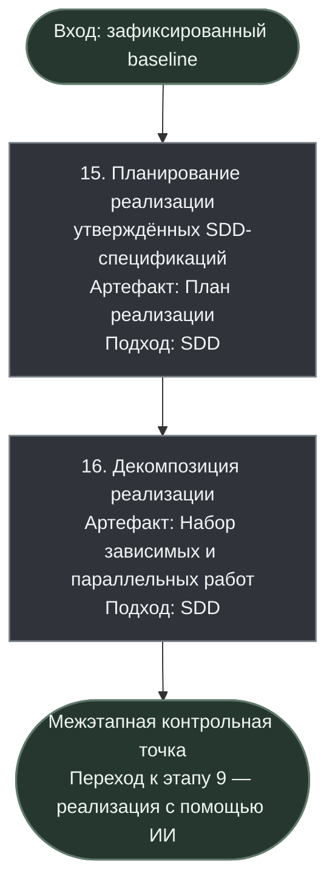

### 3.9 Этап 9 — Реализация с помощью ИИ

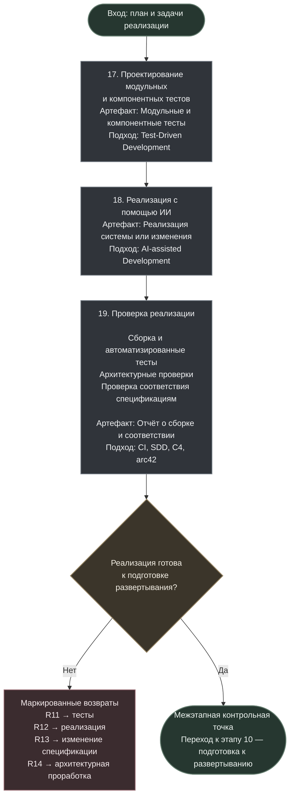

### 3.10 Этап 10 — Подготовка к развертыванию

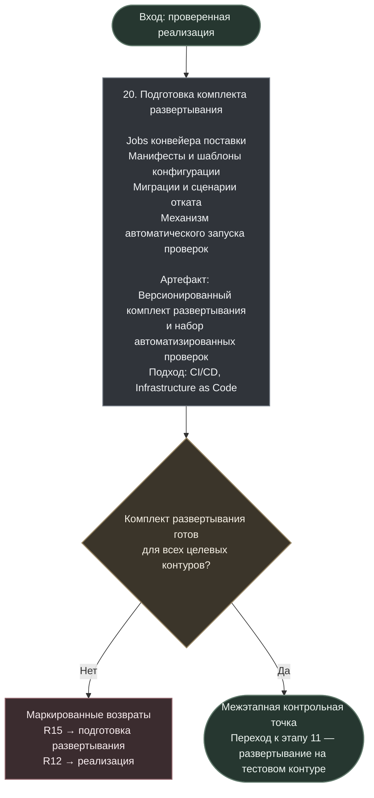

### 3.11 Этап 11 — Развертывание на тестовом контуре

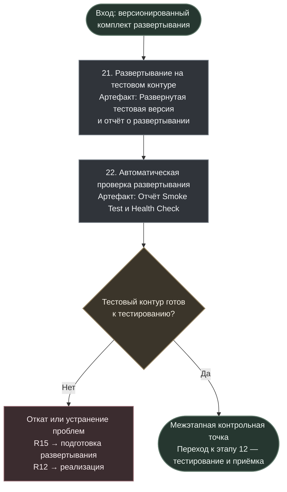

### 3.12 Этап 12 — Тестирование и приёмка

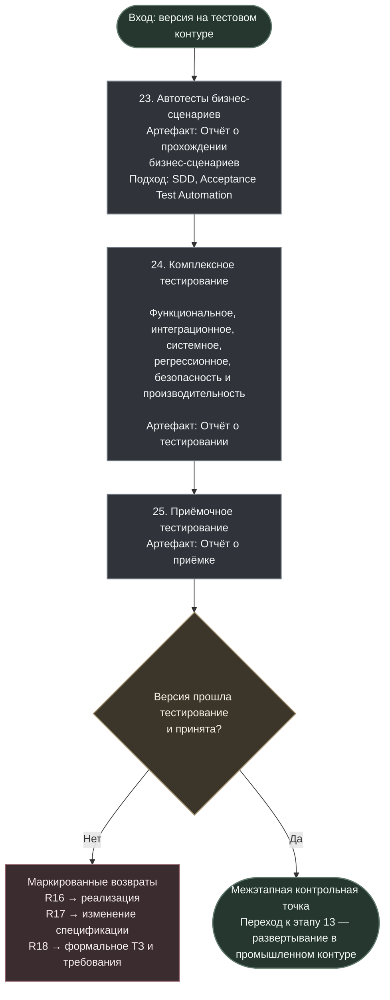

### 3.13 Этап 13 — Развертывание в промышленном контуре

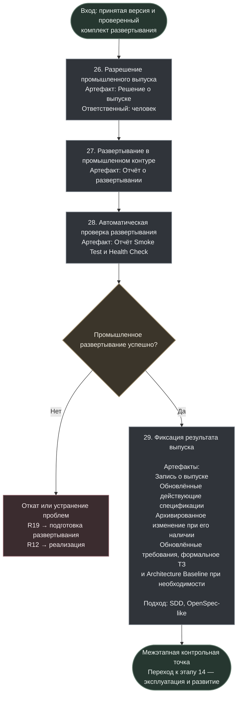

### 3.14 Этап 14 — Эксплуатация и развитие

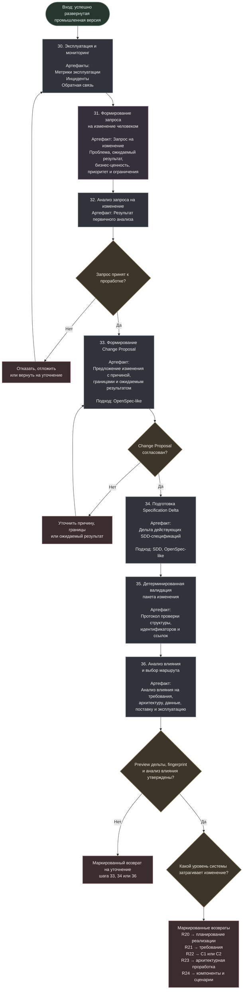

## 4. Легенда

| Обозначение | Значение |
| --- | --- |
| Артефакт | Основной сохраняемый результат шага |
| Подход | Методология, нотация или структура документации, применяемая на шаге |
| SRS | Software Requirements Specification — функция формального описания требований, реализованная в данном стандарте модульным формальным ТЗ |
| C4 Level 1 | System Context: система, пользователи и внешние системы |
| C4 Level 2 | Container: приложения, службы и хранилища системы |
| C4 Level 3 | Component: компоненты внутри одного контейнера |
| C4 Dynamic | Взаимодействие элементов при выполнении сценария |
| arc42 | Структура архитектурной документации |
| ADR | Architecture Decision Record — запись архитектурного решения |
| SDD | Spec-Driven Development — разработка на основе спецификаций |
| OpenSpec-like | Управление долгоживущими спецификациями через действующее состояние, предложение, дельту, применение и архивирование |
| Пакет определения продукта | Материалы источников, анализа, обзора продукта, сценариев, требований и сборки ТЗ в `docs/product-definition/` |
| Реестр источников | Учёт происхождения, версии и расположения входных материалов; не является реестром созданных проектом артефактов |
| Реестр артефактов | Единый каталог созданных проектом результатов с устойчивыми ID, типами, путями и статусами |
| Формальное ТЗ | Управляемое представление, собираемое из утверждённых модульных артефактов по `technical-specification.yaml` |
| Сквозной план | `project-plan.yaml`, содержащий этапы, критерии, работы, зависимости и статусы всего жизненного цикла |
| Оперативное состояние | `project-state.yaml`, содержащий компактную точку продолжения: текущий этап, рабочий фокус, активное изменение, baseline и следующие действия |
| Статус проекта для человека | Корневой `PROJECT_STATUS.md`, автоматически формируемое производное представление `project-plan.yaml` и `project-state.yaml`; не является источником состояния |
| Входная/выходная готовность | Вычисляемая доля проверенных применимых обязательных критериев входа или выхода этапа |
| Подсистема | Часть родительской системы, которая получает собственные C1, C2 и baseline только при рассмотрении как самостоятельная программная система |
| C4 Component | Компонент внутри одного контейнера C4; сам по себе не является подсистемой и не запускает отдельный процесс требований |
| Architecture Baseline | Утверждённая и версионированная архитектура |
| Действующие спецификации | Нормативное описание поведения текущей версии системы |
| Запрос на изменение | Человеческое описание проблемы, потребности и ожидаемого результата |
| Предложение изменения | Формализованное описание причины и области изменения |
| Дельта спецификации | Требования, которые нужно добавить, заменить или удалить |
| R1…R27 | Логические возвраты к предыдущим шагам без длинных пересекающихся линий |

## 5. Официальные разделы arc42

Официальные названия разделов arc42 сохраняются в оригинале:

| Раздел | Название | Основной источник в процессе |
| --- | --- | --- |
| §1 | Introduction and Goals | Анализ требований и ограничений |
| §2 | Architecture Constraints | Анализ требований и ограничений |
| §3 | Context and Scope | C1 System Context |
| §4 | Solution Strategy | Архитектурная проработка |
| §5 | Building Block View | C2 и C3 |
| §6 | Runtime View | Dynamic C2 и Dynamic C3 |
| §7 | Deployment View | Архитектурная проработка |
| §8 | Crosscutting Concepts | Архитектурная проработка |
| §9 | Architecture Decisions | ADR, создаваемые во время архитектурной проработки |
| §10 | Quality Requirements | Сценарии качества |
| §11 | Risks and Technical Debt | Реестр подтверждённых рисков и технического долга |
| §12 | Glossary | Ссылается на предметный и технический глоссарии в `docs/glossary/` |

Нумерация arc42 задаёт структуру итоговой документации, а не обязательный порядок архитектурной работы.

## 6. Правила выполнения этапов

### 6.1 Управление исходными материалами

Новый документ, протокол встречи, сообщение заказчика или выгрузка сначала регистрируется как исходный материал и не становится требованием автоматически. Для него фиксируются ID, тип, название, происхождение, дата получения, версия, расположение, область влияния, статус и контрольная сумма при наличии файла. Оригинальная формулировка не изменяется; нормализованная рабочая копия хранится отдельно и ссылается на оригинал. При расхождении приоритет имеет подтверждённый оригинал либо решение назначенного полномочного лица.

Канонический учёт ведётся в `docs/product-definition/sources/source-register.yaml`. Исходник может храниться в Git или во внешнем защищённом хранилище; во втором случае реестр содержит URI, версию и контрольную сумму. Исходник не регистрируется как созданный проектом артефакт.

```yaml
sources:
  - id: SRC-012
    kind: meeting_protocol
    title: Уточнение процесса согласования заявки
    received_at: 2026-10-06
    location: sharepoint://project/protocols/2026-10-06
    checksum: sha256:...
    status: accepted
```

### 6.2 Видение продукта и бизнес-цели

До предметной детализации фиксируются проблема и ценность продукта, целевые пользователи, бизнес-цели, критерии успеха, границы MVP и предварительная область применения. Результат сохраняется в `product-vision.md`, `product-goals.md` и `system-scope.md`. Предварительная область применения не заменяет C1: она задаёт бизнес-рамку, которую C1 позднее уточняет как системную границу.

### 6.3 Предметный анализ

На основе подтверждённых источников и видения продукта в необходимом для проекта объёме анализируются:

- пользователи, роли и обязанности;
- существующие и целевые процессы;
- предметные сущности и их жизненные циклы;
- бизнес-правила, отчётность, ручные и автоматизируемые действия;
- ограничения и внешние зависимости;
- пробелы, противоречия, допущения и открытые вопросы.

Существенные записи классифицируются как `fact`, `analytical_conclusion`, `requirement`, `decision`, `assumption`, `open_question` или `conflict`; размечать каждое предложение документа не требуется. Коллизии, допущения, вопросы и решения фиксируются с ID, связанными источниками и артефактами, вариантами, последствиями, полномочной ролью, итогом, датой и статусом. ИИ не должен превращать неизвестные данные в решения молча.

### 6.4 Нормативные требования

Требования не считаются заранее полными. Аналитический вывод становится нормативным требованием только после подтверждения человеком и переноса в соответствующий канонический артефакт. Раздельно ведутся бизнес-, функциональные и нефункциональные требования, матрица ролей и доступов и ограничения. Требование должно иметь устойчивый ID, источник или обоснование, критерий проверяемости и связи трассировки.

### 6.5 Бизнес-сценарии и критерии приёмки

Бизнес-сценарии формируются после первоначального набора нормативных требований и описывают цель участника, предусловия, основной и альтернативные потоки, ожидаемый результат и связанные требования. Критерии приёмки задают наблюдаемые условия успешного выполнения сценария. Сценарии используются как проверка полноты требований: обнаруженный пробел возвращает работу к предметному анализу или нормативному требованию, а не маскируется внутри сценария.

### 6.6 Пакет определения продукта и формальное ТЗ

Физической границей материалов определения продукта является `docs/product-definition/`. Отдельный `product-definition.yaml` не используется: назначение задаётся структурой каталогов, артефакты разрешаются через `docs/artifact-register.yaml`, а версия согласованного состояния определяется Git-коммитом или тегом.

Пакет включает исходники, результаты анализа, обзор продукта, бизнес-сценарии и модульные требования. Формальное ТЗ является управляемым представлением этих и связанных архитектурных артефактов. Его единственный манифест — `docs/product-definition/technical-specification.yaml`.

После согласования C1, C2 и Dynamic C2 сначала уточняются и согласуются нормативные требования. Только затем из утверждённых модульных артефактов собирается формальное ТЗ. Сборка ТЗ не должна незаметно менять смысл требований: содержательная правка возвращается в канонический артефакт, после чего представление собирается повторно.

ТЗ собирается из целых утверждённых артефактов. Поля `owner`, `fragment`, `section` и `included_in_technical_specification` в базовой модели не используются. Порядок массива `sections` задаёт порядок разделов, `title` — отображаемый заголовок, нумерация формируется сборщиком.

Рекомендуемые логические модули: бизнес-контекст и цели, область применения и границы, бизнес-требования, роли и доступы, функциональные и нефункциональные требования, данные и предметные сущности, интеграции, бизнес-сценарии, критерии приёмки, ограничения, решения и открытые вопросы, а также ссылки на существенные C4 и ADR.

```yaml
document:
  title: Техническое задание
  version: "1.0"
sections:
  - title: Бизнес-контекст и цели
    content:
      - artifact: ART-PRODUCT-VISION
        mode: include
      - artifact: ART-PRODUCT-GOALS
        mode: include
  - title: Область применения и границы
    content:
      - artifact: ART-SYSTEM-SCOPE
        mode: include
  - title: Бизнес-требования
    content:
      - artifact: ART-BUSINESS-REQUIREMENTS
        mode: include
  - title: Функциональные требования
    content:
      - artifact: ART-FUNCTIONAL-REQUIREMENTS
        mode: include
  - title: Нефункциональные требования
    content:
      - artifact: ART-NON-FUNCTIONAL-REQUIREMENTS
        mode: include
  - title: Матрица ролей и доступов
    content:
      - artifact: ART-ROLES-AND-ACCESS
        mode: appendix
  - title: Данные и предметные сущности
    content:
      - artifact: ART-DOMAIN-MODEL
        mode: include
  - title: Бизнес-сценарии
    content:
      - artifact: ART-BUSINESS-SCENARIOS
        mode: appendix
  - title: Критерии приёмки
    content:
      - artifact: ART-ACCEPTANCE-CRITERIA
        mode: include
  - title: Предметный глоссарий
    content:
      - artifact: ART-DOMAIN-GLOSSARY
        mode: appendix
  - title: Контекст системы
    content:
      - artifact: ART-C4-SYSTEM-CONTEXT
        mode: reference
```

Допустимые режимы: `include`, `appendix`, `reference`. Исходники в ТЗ не включаются; при юридической необходимости приводится ссылка на основание. C1 обычно включается или прикладывается, C2 и Dynamic C2 — по договорной необходимости, C3, Dynamic C3 и ADR обычно указываются ссылками. Канонические C4-файлы не копируются в каталог определения продукта.

Собранные Markdown, DOCX и PDF не становятся независимыми источниками истины, вручную не редактируются и при локальном хранении размещаются в `technical-specification-releases/`. Каталог необязателен, если выпуски публикуются через CI/CD, Git-релизы или систему документооборота.

### 6.7 Сквозная трассировка

Каноническое место трассировки — `docs/traceability/traceability.yaml`. Трассировка хранит отношения между сущностями, но не подменяет аналитические обоснования и ADR.

```text
Исходный материал или решение
→ аналитический вывод
→ бизнес-требование
→ бизнес-сценарий
→ функциональное или нефункциональное требование
→ критерий приёмки
→ архитектурное решение
→ SDD-спецификация
→ реализация
→ тест
→ выпуск
```

Для редакционной правки не требуется искусственно создавать все звенья. Полнота цепочки определяется маршрутом изменения и этапом жизненного цикла.

### 6.8 C1, C2, Dynamic C2 и родительский контекст

- C1 определяет границу системы, пользователей и внешние системы.
- C2 определяет развёртываемые приложения, службы и хранилища, их ответственность, технологии и связи.
- Dynamic C2 создаётся для каждого бизнес-сценария и показывает участие контейнеров в его выполнении.
- Статическая C2 относится к arc42 Building Block View, Dynamic C2 — к Runtime View.

Для подсистемы до проектирования определяются родительское требование и сценарий, роли, владение и использование данных, граничные интерфейсы и события, решения родительского уровня и интеграционные критерии приёмки. Собственные C1, C2 и baseline создаются только если подсистема рассматривается как самостоятельная программная система. C4 Component внутри контейнера не получает их автоматически. Изменение общих ролей, границ, контрактов или владения данными сначала оформляется на уровне родительской системы.

### 6.9 Архитектурная проработка

Архитектурная проработка опирается на согласованное формальное ТЗ, C1, C2, Dynamic C2 и известные технические, организационные и нормативные ограничения.

Пакет архитектурной проработки содержит Quality Requirements, Solution Strategy, Deployment View, Crosscutting Concepts, Architecture Decisions в форме ADR, Risks and Technical Debt. Реестр архитектурных вопросов и вариантов содержит допущения, открытые вопросы, риски, сравнение вариантов, меры минимизации и решения, требующие подтверждения человека.

### 6.10 C3, Dynamic C3 и SDD

- одна C3 Component Diagram описывает компоненты внутри одного контейнера;
- C3 создаётся только для контейнеров, которым действительно требуется детализация;
- для каждого бизнес-сценария создаётся Dynamic C3 внутри каждого затрагиваемого детализируемого контейнера;
- одновременно создаётся черновая SDD-спецификация сценария;
- спецификация связывает требования, сценарий, C2, Dynamic C2, C3, Dynamic C3, интерфейсы, события, правила, ошибки и критерии приёмки;
- после утверждения baseline черновые спецификации становятся действующими.

### 6.11 Глоссарии и фиксация исходного baseline

Предметный глоссарий `docs/glossary/domain-glossary.md` развивается с этапа 1, используется требованиями, сценариями и архитектурой и по умолчанию включается в ТЗ. Технический глоссарий `docs/glossary/technical-glossary.md` развивается при архитектурной работе, используется C4, arc42, ADR и SDD и по умолчанию в ТЗ не включается. Оба получают статус `approved` при фиксации соответствующего baseline.

Фиксация baseline не является новым проектированием. Она включает сборку Architecture Documentation по arc42, проверку согласованности определения продукта, формального ТЗ, C4 и SDD, закрытие либо явное принятие критических вопросов и рисков, перевод спецификаций в действующие, присвоение версий и фиксацию Git-коммита или тега. Baseline ссылается на точную версию определения продукта, формальное ТЗ, доменную модель, состав системы, ADR, C4 и действующие SDD-спецификации.

### 6.12 Реализация, тестирование и развертывание

- модульные и компонентные тесты проектируются до или вместе с реализацией;
- после проверки реализации создаётся один версионированный комплект развертывания: jobs, манифесты, конфигурация, миграции, откат и механизм автоматических проверок;
- неизменяемый комплект используется на тестовом и промышленном контурах; различаются параметры окружения и защищённые значения;
- до тестирования версия развёртывается на тестовом контуре и проходит Smoke Test и Health Check;
- автотесты бизнес-сценариев выполняются на тестовом контуре;
- комплексное тестирование включает функциональное, интеграционное, системное, регрессионное тестирование, безопасность и производительность;
- приёмочное тестирование завершает этап тестирования, решение о приёмке принимает человек;
- после приёмки человек разрешает промышленный выпуск, затем тот же комплект продвигается в промышленный контур и повторно проходит Smoke Test и Health Check;
- при неуспешном развертывании дельта не применяется к действующим спецификациям и не архивируется.

### 6.13 Эксплуатация и маршруты изменений

Человек создаёт запрос на изменение на языке проблемы, ценности и ожидаемого результата, не проектируя техническое решение. После первичного анализа и принятия запроса работа выполняется последовательно:

1. Change Proposal фиксирует причину, границы и ожидаемый результат;
2. Specification Delta задаёт точные операции над действующими SDD-спецификациями;
3. детерминированная валидация проверяет структуру, ID, ссылки и применимость дельты;
4. анализ влияния определяет затронутые требования, архитектуру, данные, интеграции, безопасность, поставку и эксплуатацию и выбирает маршрут возврата;
5. preview точного результата и его fingerprint утверждаются человеком;
6. после согласования создаётся план реализации.

Сначала определяется маршрут:

| Маршрут | Условие | Процедура |
| --- | --- | --- |
| Редакционная правка | Смысл и поведение не меняются | Обычный проверяемый коммит |
| Уточнение до baseline | Меняется черновой артефакт, действующей спецификации ещё нет | Обновление анализа, требований и трассировки с согласованием |
| Изменение после baseline | Меняется утверждённое требование, архитектура или действующая спецификация | Change Request, анализ влияния и управляемая дельта |

Независимо отмечается влияние на `requirements`, `architecture`, `specification`, `data`, `integration`, `security`, `deployment`, `operations`. При влиянии на действующую спецификацию выполняется полный OpenSpec-like цикл; при влиянии на архитектуру обновляются C4, ADR и arc42.

ИИ работает с минимальным достаточным контекстом: релевантной частью действующих спецификаций, утверждаемой дельтой и связанными требованиями, C4 и ADR. После успешного промышленного развертывания дельта применяется, изменение архивируется, а требования, формальное ТЗ и Architecture Baseline обновляются только при фактическом влиянии.

Новый материал, полученный в ходе проекта, всегда сначала регистрируется в `source-register.yaml` и проходит анализ. До baseline он может привести к уточнению черновых артефактов; после baseline смысловое изменение оформляется через Change Request, анализ влияния и управляемую дельту. Редакционные исправления, не меняющие смысл, выполняются обычным проверяемым коммитом.

## 7. Ответственность человека и ИИ

| Область | ИИ | Человек |
| --- | --- | --- |
| Исходные материалы | Регистрирует, проверяет целостность, нормализует копии и выявляет расхождения | Подтверждает происхождение и разрешает содержательные конфликты |
| Видение продукта | Формализует проблему, цели, критерии успеха и предварительные границы | Определяет ценность, приоритеты и подтверждает направление продукта |
| Предметный анализ | Выявляет пробелы, моделирует процессы, сущности и правила | Уточняет факты и принимает предметные решения |
| Нормативные требования | Готовит проверяемые формулировки и связи с источниками | Согласует смысл и утверждает требования |
| Бизнес-сценарии | Формирует основные и альтернативные потоки и критерии приёмки | Подтверждает ожидаемое поведение и приёмочные условия |
| Формальное ТЗ | Собирает представление из утверждённых артефактов и проверяет ссылки | Утверждает состав и редакцию ТЗ |
| Трассировка | Поддерживает связи и проверяет их целостность | Подтверждает спорные смысловые связи |
| C1 и C2 | Проектирует варианты и проверяет сценарии | Согласует границы и структуру |
| Архитектурная проработка | Формирует варианты, ADR, риски и меры | Выбирает существенные решения |
| C3 и спецификации | Формирует диаграммы и трассировку | Согласует значимые границы и поведение |
| Baseline | Проверяет согласованность и готовит фиксацию | Утверждает версию |
| Сквозное планирование | Декомпозирует этапы, проверяет зависимости и области изменений, рассчитывает готовность и предлагает перепланирование | Определяет приоритеты, утверждает существенные изменения плана и межэтапные переходы |
| Координация параллельных работ | Управляющий ИИ может обновлять канонический план и объединять результаты | Назначает единственного координатора и разрешает конфликты |
| Код и тесты | Реализует и выполняет автоматические проверки | Контролирует критичные решения |
| Подготовка к развертыванию | Создаёт jobs, манифесты, конфигурацию и автоматизированные проверки | Утверждает требования к контурам, доступам и выпуску |
| Развертывание на тестовом контуре | Автоматизирует развертывание, Smoke Test и Health Check | Контролирует доступность тестового контура |
| Тестирование и приёмка | Выполняет автотесты бизнес-сценариев и остальные проверки, готовит отчёты | Утверждает критерии, принимает либо отклоняет версию |
| Развертывание в промышленном контуре | Продвигает проверенный комплект и выполняет проверки | Разрешает выпуск согласно уровню риска |
| Запрос на изменение | Помогает оформить | Инициирует и приоритизирует |
| Change Proposal | Формализует причину, границы и ожидаемый результат | Утверждает необходимость и область изменения |
| Specification Delta | Формирует точные операции над спецификациями | Утверждает точное изменение поведения |
| Валидация и анализ влияния | Проверяет пакет и определяет затрагиваемые артефакты и маршрут | Разрешает спорные последствия и существенные изменения |

## 8. Маршруты возврата

| Маркер | Целевой шаг | Типичная причина |
| --- | --- | --- |
| R1 | 7 — C1 | Ошибка границы системы или внешнего взаимодействия |
| R2 | 5 — Бизнес-сценарии и критерии приёмки | Неполный или противоречивый сценарий |
| R3 | 8 — C2 | Ошибка ответственности или связи контейнеров |
| R4 | 10 — Уточнение нормативных требований | Архитектура выявила дефект требования |
| R5 | 8 — C2 | Архитектурная проработка требует изменить контейнеры |
| R6 | 12 — Архитектурная проработка | Требуется выбрать другой архитектурный вариант |
| R7 | 12 — Архитектурная проработка | Компоненты противоречат общим решениям |
| R8 | 8 — C2 | Ошибка границ контейнера |
| R9 | 13 — Сценарная детализация | Ошибка C3, Dynamic C3 или черновой спецификации |
| R10 | 10 — Уточнение нормативных требований | Обнаружен дефект исходного требования |
| R11 | 17 — Модульные и компонентные тесты | Недостаточные или ошибочные тесты |
| R12 | 18 — Реализация | Ошибка кода |
| R13 | 34 — Specification Delta | Реализация выявила дефект спецификации |
| R14 | 12 — Архитектурная проработка | Реализация выявила архитектурную проблему |
| R15 | 20 — Подготовка развертывания | Ошибка jobs, манифестов, конфигурации, миграции или автоматизированной проверки |
| R16 | 18 — Реализация | Тестирование выявило дефект кода |
| R17 | 34 — Specification Delta | Тестирование или приёмка выявили дефект спецификации |
| R18 | 10 — Уточнение нормативных требований | Приёмка выявила неверное требование |
| R19 | 20 — Подготовка развертывания | Промышленное развертывание выявило дефект комплекта поставки |
| R20 | 15 — Детальное планирование реализации | Локальное изменение без изменения архитектуры |
| R21 | 10 — Уточнение нормативных требований | Меняется требование |
| R22 | 7 или 8 — C1/C2 | Меняются границы системы или контейнеры |
| R23 | 12 — Архитектурная проработка | Меняются общие архитектурные решения |
| R24 | 13 — Сценарная детализация | Меняются компоненты, взаимодействия или сценарии |
| R25 | 1 — Регистрация и проверка источников | Обнаружен дефект исходного материала, версии или происхождения |
| R26 | 2, 3 или 4 — Видение, предметный анализ или требования | Выявлена неподтверждённая цель, пробел, коллизия или неполное бизнес-требование |
| R27 | 13 — SDD-спецификация | Требование согласовано, но спецификация не отражает требуемое поведение |

## 9. Рекомендуемая структура каталогов

```text
project/                                           # Корневой каталог проекта
├── .spec-changes.yaml                             # Конфигурация OpenSpec-like управления SDD-спецификациями
├── PROJECT_STATUS.md                              # Автоматически формируемая человекочитаемая точка входа в состояние проекта
├── docs/                                          # Управляемая проектная документация
│   ├── artifact-register.yaml                     # Общий реестр созданных проектом артефактов
│   ├── glossary/                                  # Единая терминология проекта
│   │   ├── domain-glossary.md                     # Предметные и системные термины
│   │   └── technical-glossary.md                  # Архитектурные и технологические термины
│   ├── traceability/                              # Сквозные связи между источниками и результатами разработки
│   │   └── traceability.yaml                      # Граф трассировки требований, архитектуры, SDD, тестов и выпусков
│   ├── product-definition/                        # Определение продукта и материалы формирования ТЗ
│   │   ├── sources/                               # Исходные документы и внешние ссылки
│   │   │   ├── source-register.yaml               # Реестр происхождения, версий и расположения исходников
│   │   │   └── ...                                # Исходники при допустимости их хранения в Git
│   │   ├── analysis/                              # Результаты анализа исходных материалов
│   │   │   ├── requirements-analysis.md           # Общий анализ и нормализация требований
│   │   │   ├── domain-model.md                    # Модель предметной области
│   │   │   ├── roles-and-processes.md             # Роли и существующие либо целевые процессы
│   │   │   ├── entity-lifecycles.md               # Жизненные циклы предметных сущностей
│   │   │   ├── gaps-and-conflicts.md              # Пробелы, противоречия и коллизии
│   │   │   ├── assumptions.md                     # Принятые допущения
│   │   │   └── open-questions.md                  # Нерешённые вопросы
│   │   ├── business-scenarios/                    # Бизнес-кейсы и пользовательские сценарии
│   │   │   └── ...                                # Отдельные документы сценариев
│   │   ├── product-overview/                      # Видение, цели и границы продукта
│   │   │   ├── product-vision.md                  # Видение продукта
│   │   │   ├── product-goals.md                   # Бизнес-цели и ожидаемые результаты
│   │   │   └── system-scope.md                    # Область применения и границы системы
│   │   ├── requirements/                          # Согласуемые нормативные требования
│   │   │   ├── business-requirements.md           # Бизнес-требования
│   │   │   ├── roles-and-access-matrix.md         # Матрица ролей и прав доступа
│   │   │   ├── functional-requirements.md         # Функциональные требования
│   │   │   ├── non-functional-requirements.md     # Нефункциональные требования
│   │   │   ├── constraints.md                     # Ограничения разработки и эксплуатации
│   │   │   └── acceptance-criteria.md             # Критерии приёмки
│   │   ├── technical-specification.yaml           # Манифест состава и порядка сборки формального ТЗ
│   │   └── technical-specification-releases/      # Утверждённые выпуски ТЗ при локальном хранении
│   ├── architecture/                              # Архитектурное описание по C4, arc42 и ADR
│   │   ├── arc42/                                 # Разделы архитектурного описания arc42
│   │   │   ├── 01-introduction-and-goals.md       # Раздел Introduction and Goals
│   │   │   ├── 02-architecture-constraints.md     # Раздел Architecture Constraints
│   │   │   ├── 03-context-and-scope.md            # Раздел Context and Scope
│   │   │   ├── 04-solution-strategy.md            # Раздел Solution Strategy
│   │   │   ├── 05-building-block-view.md          # Раздел Building Block View
│   │   │   ├── 06-runtime-view.md                 # Раздел Runtime View
│   │   │   ├── 07-deployment-view.md              # Раздел Deployment View
│   │   │   ├── 08-crosscutting-concepts.md        # Раздел Crosscutting Concepts
│   │   │   ├── 09-architecture-decisions.md       # Раздел Architecture Decisions
│   │   │   ├── 10-quality-requirements.md         # Раздел Quality Requirements
│   │   │   ├── 11-risks-and-technical-debt.md     # Раздел Risks and Technical Debt
│   │   │   └── 12-glossary.md                     # Ссылки на канонические глоссарии
│   │   ├── c4/                                    # Канонические C4-диаграммы
│   │   │   ├── c1/                                # Контекст системы C4 Level 1
│   │   │   │   └── system-context.md              # Диаграмма System Context
│   │   │   ├── c2/                                # Контейнерная архитектура C4 Level 2
│   │   │   │   └── container-diagram.md           # Диаграмма Container
│   │   │   ├── c3/                                # Компоненты детализируемых контейнеров C4 Level 3
│   │   │   │   └── ...                            # Каталоги по контейнерам и Component Diagram
│   │   │   └── dynamic/                           # Динамические диаграммы сценариев
│   │   │       ├── c2/                            # Dynamic C2 для всех бизнес-сценариев
│   │   │       │   └── ...                        # Файлы по идентификаторам сценариев
│   │   │       └── c3/                            # Dynamic C3 для детализируемых контейнеров
│   │   │           └── ...                        # Каталоги контейнеров и сценариев
│   │   ├── elaboration/                           # Материалы архитектурной проработки
│   │   │   ├── architecture-elaboration-package.md # Сводный пакет архитектурной проработки
│   │   │   └── issues-and-options-register.md     # Вопросы, варианты, риски и меры минимизации
│   │   ├── decisions/                             # Архитектурные решения ADR
│   │   │   └── ...                                # Отдельные ADR-файлы
│   │   ├── impact/                                # Анализ архитектурного влияния изменений
│   │   │   └── ...                                # Файлы по идентификаторам изменений
│   │   └── baselines/                             # Версионированные архитектурные baseline
│   │       └── ...                                # YAML-файлы baseline
│   ├── sdd-specifications/                        # Действующие SDD-спецификации и управляемые изменения
│   │   ├── current/                               # Нормативное поведение текущей версии системы
│   │   │   └── ...                                # Спецификации по функциональным областям
│   │   └── changes/                               # Предлагаемые и применённые дельты спецификаций
│   │       ├── active/                            # Активные пакеты изменений
│   │       │   └── ...                            # Каталоги изменений с change.md и delta.md
│   │       └── archive/                           # Неизменяемая история применённых изменений
│   │           └── ...                            # Архивные пакеты с доказательствами применения
│   ├── testing/                                   # Тестовая стратегия, планы и отчёты
│   ├── operations/                                # Эксплуатационная документация и регламенты
│   │   ├── change-requests/                       # Человеческие запросы на изменение
│   │   │   ├── active/                            # Запросы в работе
│   │   │   └── closed/                            # Закрытые, отклонённые и завершённые запросы
│   │   ├── incidents/                             # Инциденты эксплуатации
│   │   ├── monitoring/                            # Метрики и правила мониторинга
│   │   ├── runbooks/                              # Эксплуатационные инструкции
│   │   └── deployment-reports/                    # Отчёты о развертываниях
│   ├── project-control/                           # Сквозное планирование и оперативное управление проектом
│   │   ├── project-plan.yaml                      # План этапов, работ, зависимостей, критериев и статусов
│   │   └── project-state.yaml                     # Точка продолжения: текущий этап, рабочий фокус и следующие действия
│   ├── plans/                                     # Подробные планы, на которые ссылается сквозной план
│   │   ├── stages/                                # Планы этапов, требующих отдельного порядка выполнения
│   │   ├── implementations/                       # Планы реализации утверждённых SDD-спецификаций
│   │   └── changes/                               # Планы изменений, требующих отдельного порядка выполнения
│   └── releases/                                  # Записи о выпусках и связи с реализованными изменениями
├── deployment/                                    # Манифесты, задания и средства развёртывания
│   ├── jobs/                                      # Задания конвейера поставки
│   ├── manifests/                                 # Манифесты развертывания
│   ├── environments/                              # Параметры целевых контуров без секретов
│   │   ├── development/                           # Параметры среды разработки
│   │   ├── testing/                               # Параметры тестового контура
│   │   └── production/                            # Параметры промышленного контура
│   ├── migrations/                                # Миграции данных и схем
│   ├── checks/                                    # Автоматические проверки развертывания
│   │   ├── smoke/                                 # Проверки Smoke Test
│   │   └── health/                                # Проверки Health Check
│   └── rollback/                                  # Сценарии отката
├── src/                                           # Исходный код приложения
└── tests/                                         # Автоматизированные тесты
    ├── unit/                                      # Модульные тесты
    ├── component/                                 # Компонентные тесты
    ├── integration/                               # Интеграционные тесты
    ├── system/                                    # Системные тесты
    ├── regression/                                # Регрессионные тесты
    ├── security/                                  # Тесты безопасности
    ├── performance/                               # Тесты производительности
    ├── business-scenarios/                        # Автотесты бизнес-сценариев
    └── acceptance/                                # Автоматизируемые приёмочные тесты
```

Каждый файл и каталог в эталонной структуре сопровождается русскоязычным комментарием после `#`; комментарий не является частью имени. Универсальный каталог `artifacts/`, отдельный `scenario-register.yaml`, `product-definition.yaml` и `requirements-index.md` не создаются. Проектно-специфические документы добавляются в семантически подходящий каталог и регистрируются в общем реестре артефактов.

## 10. Канонические источники, реестры и метаданные

### 10.1 Единственное место хранения каждого вида информации

| Информация | Канонический источник |
| --- | --- |
| Происхождение исходных материалов | `docs/product-definition/sources/source-register.yaml` |
| Результаты предметного анализа | `docs/product-definition/analysis/` |
| Видение, цели и границы продукта | `docs/product-definition/product-overview/` |
| Бизнес-сценарии | `docs/product-definition/business-scenarios/` |
| Нормативные требования | `docs/product-definition/requirements/` |
| Состав формального ТЗ | `docs/product-definition/technical-specification.yaml` |
| Выпускные представления ТЗ при локальном хранении | `docs/product-definition/technical-specification-releases/` |
| Предметная и техническая терминология | `docs/glossary/` |
| Сквозные связи между сущностями | `docs/traceability/traceability.yaml` |
| Реестр созданных проектом артефактов | `docs/artifact-register.yaml` |
| Структура архитектурного описания | `docs/architecture/arc42/` |
| C4-диаграммы | `docs/architecture/c4/` |
| Архитектурные решения | `docs/architecture/decisions/` |
| Архитектурные вопросы и варианты | `docs/architecture/elaboration/issues-and-options-register.md` |
| Действующее поведение | `docs/sdd-specifications/current/` |
| Активное изменение поведения | `docs/sdd-specifications/changes/active/` |
| История применённых изменений | `docs/sdd-specifications/changes/archive/` |
| Человеческие запросы | `docs/operations/change-requests/` |
| Сквозной план и статусы работ | `docs/project-control/project-plan.yaml` |
| Текущая оперативная позиция | `docs/project-control/project-state.yaml` |
| Человекочитаемая точка входа в состояние проекта | Корневой `PROJECT_STATUS.md`, производный от двух предыдущих файлов |
| Подробные планы | `docs/plans/` |
| Тестовая документация | `docs/testing/` |
| Сведения о выпусках | `docs/releases/` |

Разделы arc42 и формальное ТЗ ссылаются на канонические C4, ADR и другие артефакты, а не создают их независимые копии.

### 10.2 Реестры и устойчивые идентификаторы

Созданные проектом документы и наборы документов регистрируются в `docs/artifact-register.yaml`. Исходники учитываются только в `source-register.yaml`. Отдельный реестр сценариев не используется. Требование как проверяемое утверждение не является самостоятельной записью реестра артефактов: например, `FR-001` находится внутри `ART-FUNCTIONAL-REQUIREMENTS`.

```yaml
artifacts:
  - id: ART-FUNCTIONAL-REQUIREMENTS
    kind: functional_requirements
    path: docs/product-definition/requirements/functional-requirements.md
    status: approved
```

ID присваивается сущности, на которую нужна устойчивая ссылка или трассировка. Он не зависит от имени файла и номера раздела, не изменяется при переносе файла и не используется повторно. Поля `owner`, `fragment`, `section` и `included_in_technical_specification` в базовую запись артефакта не входят.

Базовый словарь `kind`:

```text
product_vision, product_goals, system_scope,
requirements_analysis, domain_model, roles_and_processes,
entity_lifecycles, gaps_and_conflicts, assumptions, open_questions,
business_scenario, business_scenario_catalog, business_requirements, roles_and_access_matrix,
functional_requirements, non_functional_requirements, constraints,
acceptance_criteria, domain_glossary, technical_glossary,
technical_specification_manifest, technical_specification_release,
c4_context, c4_container, c4_component, c4_dynamic,
arc42_section, adr, architecture_baseline, sdd_specification,
test_plan, test_report, deployment_package, release_record,
operations_document
```

Новый `kind` должен быть добавлен в контролируемый словарь стандарта до использования.

Базовый словарь `kind` для исходников: `contract`, `technical_specification`, `business_document`, `meeting_protocol`, `message`, `data_export`, `regulation`, `external_reference`. Расширение словаря также требует предварительного изменения стандарта.

| Объект | Допустимые статусы |
| --- | --- |
| Этап | `not_started`, `planning`, `ready`, `active`, `in_review`, `blocked`, `completed` |
| Работа | `planned`, `ready`, `in_progress`, `review`, `done`, `needs_clarification`, `blocked`, `deferred`, `cancelled` |
| Артефакт | `draft`, `in_review`, `approved`, `superseded`, `retired` |
| Исходник | `registered`, `accepted`, `superseded`, `rejected`, `unavailable` |
| Критерий готовности | `pending`, `in_review`, `verified`, `not_applicable` |

Нормальные переходы: этап `not_started → planning → ready → active → in_review → completed`; работа `planned → ready → in_progress → review → done`; артефакт `draft → in_review → approved → superseded|retired`; исходник `registered → accepted|rejected|unavailable`, затем при замене `accepted → superseded`; критерий `pending → in_review → verified|not_applicable`. `blocked`, `needs_clarification` и `deferred` являются временными ответвлениями с возвратом в предыдущее исполнимое состояние после устранения причины; `cancelled`, `rejected`, `retired` и `superseded` терминальны для конкретной версии записи. Неуспешная проверка возвращает этап в `active`, работу — в `in_progress`, артефакт — в `draft`, критерий — в `pending`.

Статус этапа и работы хранится только в `project-plan.yaml`, артефакта — в `artifact-register.yaml`, исходника — в `source-register.yaml`. Статус не дублируется во front matter Markdown. `done` для работы не означает автоматически `approved` для её результата. В утверждённое ТЗ входят только артефакты `approved`. Уникальность ID, пути и допустимые значения `kind` и `status` проверяются автоматически.

### 10.3 Функции вместо параллельных предметного и инженерного слоёв

Стандарт различает функции управления источниками, предметного анализа, управления требованиями, архитектурного проектирования, управления спецификациями, реализации и проверки, выпуска и эксплуатации. Каждая функция имеет вход, результат, канонический источник и ответственную роль, но не образует отдельную копию требований, архитектуры или SDD.

## 11. Сквозное планирование и управление состоянием

### 11.1 Скользящее планирование всего жизненного цикла

Планирование охватывает все 14 этапов. При запуске они фиксируются укрупнённо — с целью, зависимостями, ожидаемыми результатами и контрольными точками. Текущий этап декомпозируется до исполнимых работ, следующий поддерживается на среднем уровне детализации, последующие не детализируются преждевременно. Этап 8 предназначен только для детального планирования реализации утверждённых SDD-спецификаций и архитектурных решений.

Канонические файлы:

```text
docs/project-control/project-plan.yaml      # Сквозной план этапов и единый реестр работ и статусов
docs/project-control/project-state.yaml     # Точка продолжения: текущий этап, рабочий фокус и следующие действия
PROJECT_STATUS.md                           # Корневая производная человекочитаемая точка входа в состояние проекта
docs/plans/stages/                          # Планы этапов, требующих отдельного порядка выполнения
docs/plans/implementations/                 # Планы реализации утверждённых SDD-спецификаций
docs/plans/changes/                         # Планы изменений, требующих отдельного порядка выполнения
```

Канонические состав работ, их статусы и зависимости хранятся в `project-plan.yaml`; `project-state.yaml` хранит точку продолжения. Изменения плана и текущей оперативной позиции фиксируются коммитами Git. Сообщение коммита должно содержать идентификаторы затронутых этапов и работ, а для блокировки, отмены, возврата или перепланирования — краткую причину изменения. Изменять канонические файлы планирования может только координатор — человек или управляющий ИИ-агент.

`project-plan.yaml` определяет, что должно быть сделано, кем, в какой зависимости, с каким результатом и в каком текущем статусе. Подробный план в `docs/plans/` описывает, как именно выполнить работу, и содержит:

- цель и границы работы;
- входные артефакты и принятые решения;
- последовательность выполнения;
- затрагиваемые файлы, компоненты и интерфейсы;
- распределение действий между исполнителями;
- точки интеграции параллельных работ;
- проверки и критерии завершения;
- риски, меры снижения и порядок отката, если они применимы.

Статусы в подробном плане не ведутся: их каноническим источником остаётся `project-plan.yaml`.

Ссылка на подробный план добавляется к этапу или работе, если безопасный и однозначный порядок выполнения нельзя полностью определить по её карточке в `project-plan.yaml`. Подробный план обязателен, если работа:

- требует согласованной последовательности изменений в нескольких компонентах или артефактах;
- выполняется несколькими исполнителями или параллельными ветвями с последующей интеграцией;
- включает миграцию данных, изменение внешних контрактов, развёртывание или процедуру отката;
- содержит существенные технические риски или промежуточные контрольные точки;
- реализует утверждённую SDD-спецификацию.

Для простой работы, полностью определённой её карточкой, отдельный подробный план не требуется.

### 11.2 Модель сквозного плана

Работы этапа образуют ориентированный ациклический граф зависимостей.

```yaml
schema_version: 1
project_id: PROJECT-001
planning_mode: rolling_wave
stages:
  - id: STAGE-01
    title: Анализ и определение продукта
    status: active
    depends_on: []
    entry_criteria:
      - id: EC-01-01
        text: Исходные материалы зарегистрированы
        mandatory: true
        status: verified
    exit_criteria:
      - id: XC-01-01
        text: Обязательные артефакты определения продукта согласованы
        mandatory: true
        approval_role: product-owner
        status: in_review
    required_artifacts:
      - ART-PRODUCT-VISION
      - ART-BUSINESS-REQUIREMENTS
    work_items:
      - id: TASK-001
        title: Нормализовать исходные требования
        status: in_progress
        executor: analyst-agent-01
        depends_on: []
        scope:
          artifacts: [ART-REQUIREMENTS-ANALYSIS]
          paths: [docs/product-definition/analysis/]
        produces: [ART-REQUIREMENTS-ANALYSIS]
  - id: STAGE-02
    title: Определение границ системы
    status: planning
    depends_on: [STAGE-01]
    plan: docs/plans/stages/STAGE-02-context-and-scope.md
```

`executor` относится к работе и не возвращает исключённое поле `owner` в модель артефакта. Если критерий требует решения человека, `approval_role` определяет полномочную роль, а при переводе критерия в `verified` фиксируются `approved_by` и `approved_at`. Для недетализированных этапов достаточно целей, зависимостей, результатов и критериев; процент готовности для них отображается как `—`.

### 11.3 Оперативное состояние и восстановление контекста

`project-plan.yaml` является единым реестром этапов и работ и каноническим источником их статусов, зависимостей, исполнителей и результатов. `project-state.yaml` хранит компактную точку продолжения:

```yaml
schema_version: 1
project_id: PROJECT-001
lifecycle_mode: initial-development
current_stage: STAGE-01
focus_work_items:
  - TASK-002
  - TASK-003
active_change: null
current_baseline: null
last_approved_artifact: ART-PRODUCT-VISION
next_actions:
  - work_item: TASK-002
    action: Завершить проверку бизнес-требований
  - work_item: TASK-003
    action: Подготовить матрицу ролей и доступов
updated_at: 2026-10-08
updated_by: planning-coordinator
```

Все указанные в `project-state.yaml` этапы и работы разрешаются по идентификаторам из `project-plan.yaml`. Если файлы противоречат друг другу, приоритет имеет `project-plan.yaml`, а оперативное состояние актуализируется координатором.

При возобновлении работы человек или ИИ:

1. определяет применимую версию этого стандарта;
2. читает `project-state.yaml` и определяет текущий этап, рабочий фокус, активное изменение, baseline и ближайшие действия;
3. находит указанные этап и работы в `project-plan.yaml` и получает их статусы, исполнителей, зависимости, области изменения и ожидаемые результаты;
4. проверяет связанные подробные планы, блокировки, принятые решения и последний согласованный вход;
5. открывает только релевантные требования, архитектуру, SDD-спецификации и другие артефакты.

Восстановление только по последнему сообщению или имени файла недостаточно.

### 11.4 Человекочитаемое представление статуса

Корневой `PROJECT_STATUS.md` автоматически формируется из `docs/project-control/project-plan.yaml` и `docs/project-control/project-state.yaml` и предназначен только для чтения человеком. Размещение в корне делает его основной человекочитаемой точкой входа при открытии репозитория. Он не является реестром работ, не входит в каноническое состояние проекта, не регистрируется как самостоятельный артефакт и не используется ИИ для определения текущего статуса или разрешённого следующего действия.

Представление содержит:

- текущий этап и режим жизненного цикла;
- действующий baseline и активное изменение;
- рабочий фокус и ближайшие действия;
- входную и выходную готовность этапов;
- работы по этапам с их ID, названиями, исполнителями, зависимостями, результатами и статусами;
- блокировки и обязательные критерии входа и выхода;
- дату актуализации из `project-state.yaml`.

Статус отображается как русская подпись и каноническое значение, например `В работе (in_progress)`, `На проверке (review)`, `Заблокировано (blocked)` и `Завершено (done)`. Каноническое значение не заменяется переводом.

Генерация детерминирована: одинаковые YAML-источники всегда дают одинаковый Markdown. Текущее время генерации в файл не включается. Заголовок `PROJECT_STATUS.md` содержит предупреждение о запрете ручного редактирования, пути к обоим YAML-источникам и общий SHA-256 отпечаток их содержимого. Для каждого YAML-файла SHA-256 вычисляется по его точным байтам; общий отпечаток равен SHA-256 от UTF-8 строки `<project-plan SHA-256>\n<project-state SHA-256>\n` с фиксированным порядком файлов.

Детерминированный генератор предоставляет две операции:

| Операция | Назначение |
| --- | --- |
| `generate` | Полностью пересобрать `PROJECT_STATUS.md` из текущих YAML-источников |
| `check` | Построить ожидаемый Markdown во временной области и сравнить его с сохранённым файлом, не изменяя рабочее дерево |

`check` завершается ошибкой, если YAML некорректен, ID или ссылка не разрешаются, `PROJECT_STATUS.md` отсутствует, устарел или был изменён вручную. Изменение `project-plan.yaml` или `project-state.yaml` не готово к коммиту или слиянию, пока `generate` не обновит представление, а `check` не подтвердит его актуальность.

`generate` и `check` выполняются после каждого изменения любого YAML-источника, перед коммитом, при слиянии параллельных ветвей и в автоматической проверке репозитория. `PROJECT_STATUS.md` хранится в Git в том же коммите, что и породившее его изменение YAML.

### 11.5 Параллельные работы

Работы разрешено запускать параллельно разными людьми или ИИ-агентами, если:

- завершены все их зависимости;
- перед запуском они имеют статус `ready`;
- `scope.artifacts` и `scope.paths` не пересекаются;
- нет общего нерешённого вопроса или блокирующего решения;
- назначены отдельные исполнители;
- предусмотрена интеграционная работа, зависящая от всех параллельных ветвей.

Признак `parallel: true` не используется: возможность параллельного запуска выводится из зависимостей и областей изменения. Для изоляции применяются отдельные Git-ветви или рабочие деревья. Координатор после проверки объединяет изменения и переводит работы в `done`. Блокировка одной ветви не останавливает независимые работы, но зависимая интеграция остаётся `planned` или `blocked`.

### 11.6 Расчёт готовности этапа

Независимо рассчитываются выходная готовность текущего и входная готовность следующего этапа:

```text
Готовность = verified обязательные применимые критерии / все обязательные применимые критерии × 100 %
```

`in_review` не увеличивает готовность. `not_applicable` исключается из знаменателя только с причиной. Процент не хранится вручную, а вычисляется из критериев. Блокировки отображаются отдельно. Процент выполненных задач допустим как справочная метрика исполнения, но не как основание для завершения этапа.

После перехода этапа в `active` его критерии фиксируются. Их добавление, удаление или изменение требует изменения плана с объяснением причины и историей Git. Пример отчёта: `STAGE-01 — active; выходная готовность 50 %; активных работ 3; блокировок 0`.

### 11.7 Межэтапная контрольная точка

Формальное уточнение следующего этапа выполняется, когда текущий находится в `in_review`, до перевода следующего в `ready`:

1. подтверждаются результаты, обязательные артефакты и выходные критерии текущего этапа;
2. уточняются работы, зависимости, области изменения и входные критерии следующего;
3. вычисляются обе готовности;
4. при 100 % и отсутствии блокировок текущий этап переводится `in_review → completed`, следующий — `planning → ready`, затем может стать `active`;
5. план, статусы и оперативное состояние фиксируются одним коммитом или проверяемым слиянием.

Если результат текущего этапа не принят, он возвращается в `active`, следующий остаётся `planning`. Если текущий принят, но следующий не готов, текущий становится `completed`, следующий остаётся `planning` либо `blocked`.

### 11.8 События перепланирования и критерий завершения этапа

План актуализируется на межэтапной точке и при появлении значимой новой информации: нового источника или требования, архитектурного решения, изменения SDD, новой зависимости, коллизии или блокировки, непрохождения контрольной точки, принятого запроса на изменение, изменения состава выпуска либо завершения работы, влияющей на зависимости.

Этап завершается только если выполнены обязательные и интеграционные работы, согласованы обязательные артефакты, обновлена трассировка, выходная готовность равна 100 % и отсутствуют блокировки завершения.

## 12. Конфигурация OpenSpec-like управления спецификациями

Файл `.spec-changes.yaml` в корне проекта:

```yaml
version: 1
specifications:
  current: docs/sdd-specifications/current
  active_changes: docs/sdd-specifications/changes/active
  archive: docs/sdd-specifications/changes/archive
identifiers:
  requirement_pattern: ^REQ-[0-9]{3,}$
  change_pattern: ^CHG-[0-9]{3,}$
```

`agents/openai.yaml` для этого механизма не требуется.

### 12.1 Действующие спецификации

```markdown
# Обработка документов

## REQ-001: Отображение состояния документа

Система должна отображать оператору текущее состояние документа.

## REQ-002: Причина отклонения документа

Если документ отклонён, система должна отображать оператору согласованную причину отклонения.
```

### 12.2 Пакет активного изменения

```text
docs/sdd-specifications/changes/active/CHG-001/
├── change.md
└── delta.md
```

`change.md`:

```markdown
---
id: CHG-001
title: Отображение причины отклонения документа
status: draft
affects:
  - document-processing.md
references:
  - docs/operations/change-requests/active/CR-001-display-rejection-reason.md
  - docs/architecture/impact/CHG-001-architecture-impact.md
---

## Причина

Оператору требуется видеть причину отклонения документа.

## Область изменения

Изменяется отображение результата обработки документа.

## Ожидаемый результат

Оператор видит причину отклонения в карточке документа.
```

`delta.md`:

```markdown
## ADDED

### REQ-002: Причина отклонения документа

Если документ отклонён, система должна отображать оператору согласованную причину отклонения.
```

При управляемом изменении действующие спецификации нельзя редактировать вручную. Валидация и preview выполняются до реализации, но применение утверждённой дельты и архивирование — только после успешного развертывания в промышленном контуре. Последовательность операций:

```text
сформировать Change Proposal
→ согласовать причину, границы и ожидаемый результат
→ подготовить Specification Delta
→ выполнить детерминированную валидацию пакета
→ провести анализ влияния и выбрать маршрут
→ сформировать preview и fingerprint
→ получить явное утверждение fingerprint
→ реализовать, протестировать и развернуть изменение
→ применить утверждённую дельту
→ проверить результат
→ архивировать изменение
```

## 13. Baseline и версии

Baseline не копирует все документы. Он фиксирует версию и местонахождение согласованных артефактов.

Пример `docs/architecture/baselines/BASELINE-001.yaml`:

```yaml
id: BASELINE-001
version: "1.0"
status: approved
git_commit: "0123456789abcdef"
artifacts:
  product_definition:
    git_commit: abc123
    git_tag: product-definition-v1.0
    technical_specification: docs/product-definition/technical-specification.yaml
    artifact_register: docs/artifact-register.yaml
    domain_model: docs/product-definition/analysis/domain-model.md
  arc42: docs/architecture/arc42
  c4: docs/architecture/c4
  architecture_decisions: docs/architecture/decisions
  system_composition: docs/architecture/c4/c2/container-diagram.md
  specifications: docs/sdd-specifications/current
  traceability: docs/traceability/traceability.yaml
approved_by:
  - system-architect
  - product-owner
```

До первого baseline должны быть согласованы цели и границы, обязательные требования и критерии приёмки, бизнес-сценарии, C1, C2 и Dynamic C2, архитектурная проработка, необходимые C3 и Dynamic C3, SDD-спецификации, критические риски и трассировка. Первая версия фиксируется до детального планирования реализации. Для последующих изменений действующий baseline не перезаписывается заранее: предлагаемые архитектурные изменения хранятся как материалы активного изменения и становятся новым baseline только после успешного развертывания в промышленном контуре.

## 14. Минимально обязательные навыки ИИ

Для работы по данной методологии ИИ-агент должен располагать следующим минимальным набором навыков. Если обязательный навык недоступен, агент должен сообщить об этом до начала соответствующего этапа и не имитировать его работу вручную без согласования с человеком.

| Навык | Назначение в методологии |
| --- | --- |
| `superpowers:using-superpowers` | Определение применимых навыков и обязательного порядка их использования перед началом работы |
| `superpowers:brainstorming` | Выявление цели, уточнение неполных требований, рассмотрение вариантов и согласование проектного решения до реализации |
| `c4-modeling` | Разработка и проверка C1, C2, C3 и Dynamic-диаграмм с соблюдением уровней абстракции C4 |
| `managing-spec-changes` | Управление долгоживущими спецификациями через отдельные действующее состояние, предложение изменения, дельту и архив |
| `superpowers:writing-plans` | Преобразование согласованной спецификации и архитектуры в проверяемый план реализации |
| `superpowers:test-driven-development` | Проектирование тестов до или вместе с реализацией и подтверждение требуемого поведения кодом |
| `superpowers:executing-plans` | Последовательное выполнение утверждённого плана с контрольными точками |
| `superpowers:systematic-debugging` | Поиск первопричины дефектов реализации, тестов и развертывания до внесения исправлений |
| `superpowers:verification-before-completion` | Обязательная проверка фактическими командами и результатами перед заявлением о завершении этапа |

### 14.1 Кастомный навык `managing-spec-changes`

`managing-spec-changes` — самостоятельный кастомный навык, разработанный для этой методологии и установленный как глобальный навык Codex в `~/.codex/skills/managing-spec-changes/`. Он не является частью OpenSpec, не вызывает команды OpenSpec и не зависит от Superpowers, C4 или структуры конкретного проекта.

Навык выведен из минимального набора свойств, необходимых для согласованного OpenSpec-like управления спецификациями:

1. Существует одно явно определённое текущее состояние спецификаций.
2. Предлагаемое изменение хранится отдельно от текущего состояния.
3. Дельта выражает операции `ADDED`, `MODIFIED` и `REMOVED` над требованиями со стабильными идентификаторами.
4. До изменения текущих спецификаций выполняются детерминированная валидация и предварительный просмотр точного результата.
5. Подтверждение человека связывается с SHA-256 отпечатком конкретного предварительного просмотра и становится недействительным при изменении исходных данных или дельты.
6. Подтверждённая дельта применяется атомарно, после чего результат повторно проверяется.
7. Только успешно применённое и проверенное изменение переносится в неизменяемый архив вместе с доказательствами применения.

Таким образом, навык воспроизводит необходимую для данного процесса модель управления состоянием спецификаций, но остаётся компактным независимым инструментом, а не локальной копией OpenSpec. Его граница ответственности ограничена спецификациями: он не разрабатывает архитектуру, не создаёт планы реализации и не изменяет программный код. В первоначальную версию навыка намеренно не включён `agents/openai.yaml`: для его детерминированной работы этот конфигурационный файл не требуется.

## 15. Инструкция для ИИ-агента

Перед началом любой работы ИИ должен:

1. Определить применимую версию методологии по этому файлу и Git-коммиту либо тегу.
2. Прочитать `project-state.yaml`, затем разрешить указанные этап и работы в `project-plan.yaml`.
3. Определять статусы и разрешённые действия только по YAML-источникам; не использовать `PROJECT_STATUS.md` для принятия процессных решений.
4. Определить режим: первоначальная разработка, уточнение до baseline или изменение после baseline.
5. Найти последний согласованный вход: пакет определения продукта, формальное ТЗ, Architecture Baseline и действующие SDD-спецификации.
6. При изменении найти человеческий запрос, активный пакет изменения, дельту и анализ влияния.
7. Проверить зависимости активной работы, её `scope`, блокировки и следующую разрешённую операцию.
8. Загружать только релевантные источники, требования, C4, ADR, сценарии и спецификации.
9. Проверять идентификаторы, статусы, версии, пути и трассировку между артефактами.
10. Новый внешний материал сначала регистрировать как источник, а не переносить прямо в требования.
11. Не считать допущение фактом и не принимать существенное архитектурное решение без ADR и утверждения человека.
12. Не изменять утверждённые требования, действующие спецификации и baseline напрямую.
13. Не переходить к работе, пока её зависимости не завершены, статус не `ready`, а область изменения не отделена от параллельных работ.
14. Не переходить к реализации до согласования спецификации и детального плана реализации.
15. Не завершать этап по количеству задач: проверить обязательные артефакты, трассировку, критерии выхода и блокировки.
16. Только координатору изменять канонические `project-plan.yaml` и `project-state.yaml`.
17. После изменения `project-plan.yaml` или `project-state.yaml` выполнить `generate` и `check` для `PROJECT_STATUS.md` до коммита или слияния.
18. Не применять дельту и не архивировать изменение до успешного развертывания в промышленном контуре.

Для каждой задачи ИИ должен уметь показать трассировку:

```text
Исходный материал или запрос на изменение
→ аналитический вывод
→ бизнес-требование
→ бизнес-сценарий
→ функциональное или нефункциональное требование
→ критерий приёмки
→ C2 и Dynamic C2
→ C3 и Dynamic C3 при необходимости
→ действующая спецификация и дельта
→ работа реализации
→ тест
→ изменение кода
→ версия выпуска
```

## 16. Критерий завершённости изменения

Изменение считается завершённым только если:

- Change Request принят;
- Change Proposal и Specification Delta утверждены;
- влияние на источники, требования, формальное ТЗ, архитектуру и эксплуатацию проанализировано;
- сквозная трассировка обновлена;
- план изменения и области параллельных работ согласованы;
- реализация и тесты завершены;
- проверка соответствия пройдена;
- приёмочное тестирование пройдено;
- развёртывание успешно;
- Smoke Test и Health Check пройдены;
- дельта применена к действующим спецификациям;
- изменение архивировано;
- требования, формальное ТЗ и Architecture Baseline обновлены при необходимости;
- критерии выхода этапа выпуска имеют статус `verified`, блокировки отсутствуют;
- выпуск связан с реализованным изменением.
