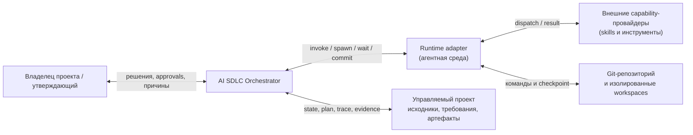
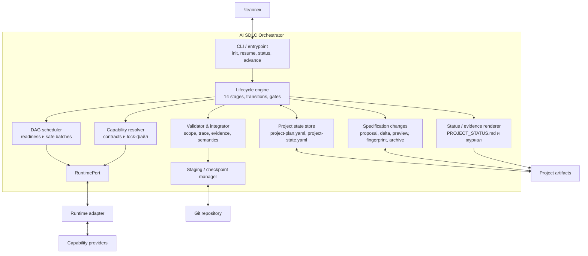
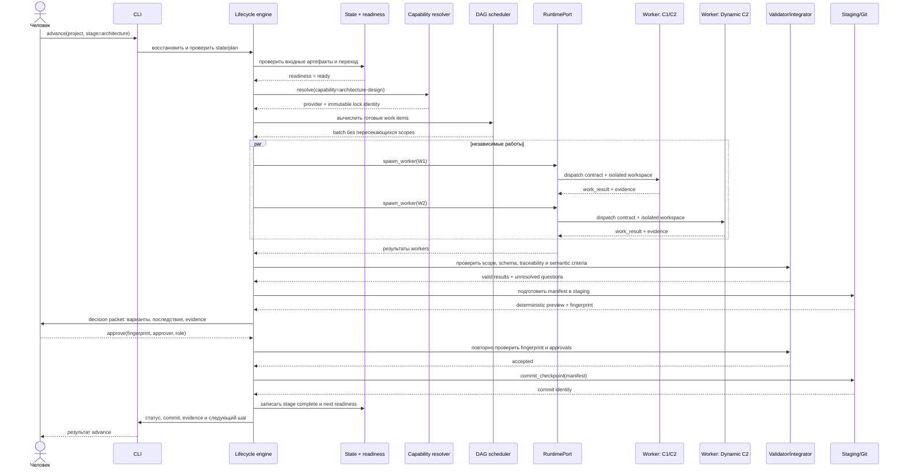

# Проектирование C1, C2 и Dynamic C2

## C1 — контекст системы

Система `AI SDLC Orchestrator` координирует полный жизненный цикл разработки по закреплённому стандарту. Человек принимает содержательные решения и утверждает контрольные точки; оркестратор восстанавливает состояние, выбирает допустимые работы, вызывает провайдеров, проверяет результаты и фиксирует только доказанные изменения.



Внешние участники и системы:

- владелец проекта — утверждает baseline, архитектуру, изменения и выпуск;
- runtime adapter — предоставляет переносимые операции запуска навыков, агентов, команд и Git;
- capability-провайдеры — выполняют специализированные работы по контрактам;
- Git — хранит канонические файлы и атомарные checkpoint-ы;
- управляемый проект — содержит код, спецификации, требования, артефакты и доказательства.

Граница ответственности оркестратора: состояние, переходы, DAG, readiness, трассировка, контракты провайдеров, staging, проверки и контрольные точки. Семантическое решение о требованиях, архитектуре и выпуске остаётся за человеком.

## C2 — контейнеры



### Основные интерфейсы контейнеров

```yaml
runtime_port:
  invoke_skill: (dispatch_contract) -> raw_result
  spawn_worker: (work_item, isolated_scope) -> worker_id
  wait_worker: (worker_id) -> work_result
  request_human_approval: (decision_packet) -> approval
  run_command: (command, scope) -> evidence
  commit_checkpoint: (prepared_manifest) -> commit_identity
```

Канонические файлы `project-plan.yaml` и `project-state.yaml` изменяет только lifecycle engine через checkpoint manager. Дочерний worker возвращает результат, список изменённых путей, проверки и нерешённые вопросы, но не меняет каноническое состояние напрямую.

Контракт capability провайдера фиксирует применимость, входы, scope, запреты, результат, evidence и policy деградации (`stop`, `fallback`, `skip_if_not_applicable` или `require_risk_decision`). Resolver выбирает провайдера по capability, версии и lock-файлу; validator не принимает результат только по факту наличия файла.

## Dynamic C2 — продвижение этапа `advance`

Сценарий: после восстановления проекта координатор готовит архитектурную работу, запускает независимые задачи параллельно, собирает результаты, проходит проверку и останавливается на человеческом утверждении baseline.



### Инварианты динамического сценария

1. Неразрешённый провайдер, невалидный результат или нарушение scope не интегрируются.
2. Параллельность вычисляется по DAG и непересекающимся `scope.paths`/`scope.artifacts`; конфликт переводится в отдельную интеграционную работу.
3. Approval относится к точному fingerprint подготовленного содержимого. Любое изменение после approval аннулирует решение и требует нового пакета.
4. Канонический статус меняется только после успешного checkpoint и получения commit identity.
5. При остановке между staging и checkpoint последним согласованным состоянием остаётся предыдущий commit; evidence ошибки сохраняется.
6. Отчёт об успешном переходе содержит изменённые артефакты, проверки, approval, провайдера и commit identity.

Этап проектирования считается завершённым: зафиксированы контекст, контейнерные границы, основные интерфейсы, динамический поток и проверяемые архитектурные инварианты.
